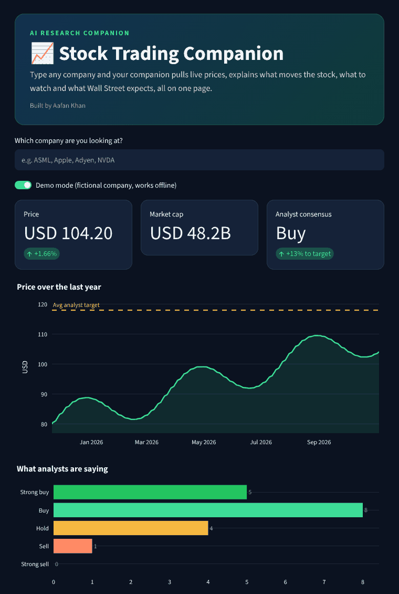

# 📈 Stock Trading Companion

**An AI research companion for investors: type any company and get a one-page briefing with the live price, what moves the stock, what to watch, Wall Street's view and the latest news.**

🔗 **Live app:** [aafan-stock-briefing.streamlit.app](https://aafan-stock-briefing.streamlit.app)



## Why I built it
Researching a stock means jumping between price charts, analyst pages, news sites and company reports. My companion pulls the key information into one briefing in seconds, written so a non-expert can understand what drives the business and what the market expects.

## What you get
1. **Snapshot:** price and daily change, day and 52-week range, market cap, P/E, dividend yield, beta
2. **What moves this stock:** the main drivers for its sector (e.g. interest rates, commodity prices, consumer spending)
3. **What to watch:** next earnings date and the key metrics investors track
4. **Wall Street view:** consensus rating, number of analysts, average and high/low price targets, rating breakdown
5. **Key signals:** plain-English observations from the numbers (volatility, position in 52-week range, expected earnings growth, upside to target)
6. **Recent news:** latest headlines with sources
7. **Optional AI summary:** with an Anthropic API key, Claude writes a short analyst-style note using only the fetched data

## How it works
```
Company name -> ticker search (Yahoo Finance) -> market data, analyst targets, news
                                                       |
                      sector rules + signal rules <----+
                                                       v
                        one-page briefing (+ optional Claude summary)
```
- `briefing/data.py`: fetches and cleans market data with `yfinance`; missing fields never crash the app
- `briefing/drivers.py`: sector drivers and rule-based signals
- `briefing/report.py`: builds the briefing and the optional AI summary
- `briefing/demo.py`: a fictional company so the app runs offline
- `tests/`: unit tests, including a mocked data feed

## Run it
```bash
git clone https://github.com/aafankhan4796-eng/stock-briefing.git
cd stock-briefing
pip install -r requirements.txt
streamlit run app.py
```
Optional AI summary: copy `.streamlit/secrets.toml.example` to `.streamlit/secrets.toml` and add your key.
Run the tests with `python -m pytest`.

## Limitations
- Free Yahoo Finance data via `yfinance` can be delayed (often ~15 minutes) and coverage varies by exchange; it is meant for personal and educational use.
- Sector drivers are general patterns, not company-specific analysis.
- **This is a research tool, not financial advice.** It shows what analysts expect; it does not make its own buy/sell recommendations.

## Next steps
- Add company-specific risk factors from annual reports (SEC EDGAR)
- Compare two stocks side by side
- Track how analyst targets change over time

---
Built by **Aafan Khan**, BSc Business Administration, University of Amsterdam · [LinkedIn](https://www.linkedin.com/in/aafan-khan)
